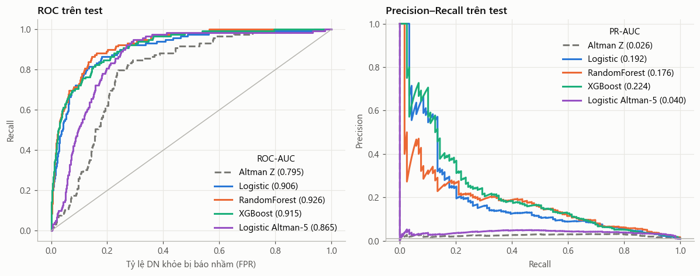

# Xếp hạng rủi ro phá sản doanh nghiệp

Từ báo cáo tài chính của 8.971 doanh nghiệp Mỹ, nghiên cứu xếp hạng rủi ro phá sản và ước tính chi phí lập danh sách rà soát. Mô hình chính theo quy tắc backtest 2012–2018 là **Logistic**. Biểu đồ và bảng dưới mô tả tập phát triển 2015–2018, gồm 119 sự kiện trên 12.282 quan sát (0,97%).



| Mô hình | ROC-AUC phát triển | PR-AUC phát triển | Brier skill¹ |
|---|---|---|---|
| Altman Z | 0,795 | 0,026 | 0,0% |
| Logistic | 0,906 | 0,192 | 9,7% |
| RandomForest | 0,926 | 0,176 | 9,3% |
| XGBoost | 0,915 | 0,224 | 8,3% |
| Logistic Altman-5 | 0,865 | 0,040 | 0,2% |

¹ Brier skill = 1 − Brier mô hình / Brier của dự báo hằng số. Hằng số là tỷ lệ sự kiện trên valid, cố định trước giai đoạn đánh giá. PR-AUC dùng Average Precision (AP).

1. **Thứ hạng thay đổi theo năm.** XGBoost gốc có AP cao hơn Logistic trong 6/7 năm. Chênh trung bình là 0,032, p kiểm định dấu hai phía bằng 0,125. XGBoost đơn điệu đạt AP trung bình 0,226, so với 0,213 của bản gốc, trên cùng bảy năm và cùng ngân sách tìm tham số.
2. **Xác suất thay đổi khi cập nhật mức nền.** Giữ độ dốc Platt và chỉnh hệ số chặn trên 2012–2014 đưa tổng sự kiện dự báo của XGBoost từ 182,8 xuống 119,5 so với 119 quan sát. Brier skill chuyển từ 9,0% sang 8,3%.
3. **Rà soát có điểm hòa vốn.** Ở kịch bản chính, Logistic dùng ngưỡng 1,37%, đưa 1742 hồ sơ vào danh sách và tìm được 97 ca. Với chi phí 1 triệu đồng/hồ sơ, hiệu quả tránh tổn thất phải đạt ít nhất 3,99% để hòa vốn trên danh sách này.

[Bản tóm tắt kết quả](REPORT_SUMMARY.md) · [Notebook phân tích](corporate-bankruptcy-prediction.ipynb)

## Dữ liệu và thiết kế đánh giá

Mỗi quan sát là một doanh nghiệp ở một năm báo cáo. Nhãn dương khi đây là năm cuối trong dữ liệu của một công ty mang nhãn `failed`. Quy ước này suy ra sự kiện ở năm kế tiếp. Dataset thiếu ngày công bố BCTC và ngày phá sản đã xác minh.

- Mô hình dùng 1999–2011 để fit và 2012–2014 để chọn tham số, cập nhật hệ số chặn và chọn ngưỡng. Mỗi mô hình học bước làm sạch từ tập huấn luyện tương ứng.
- Backtest cuốn chiếu chọn lại tham số trong quá khứ trước mỗi năm 2012–2018. Logistic là lựa chọn mặc định. XGBoost gốc chỉ thay thế khi chênh AP trung bình dương và kiểm định dấu ghép cặp theo năm đạt p < 0,05. RF và XGBoost đơn điệu là các đối chứng. Quy tắc được bổ sung sau khi đã xem dữ liệu. Bảy năm có thể phụ thuộc nhau nên cần xác nhận ở giai đoạn mới.
- Notebook còn có stress test 2007–2010, bootstrap 500 lần theo công ty cho chênh lệch mô hình/refit, độ nhạy với nhãn hai năm và kết cục chưa rõ, cờ thiếu, Logistic gọn, SHAP, PSI/CSI và thứ tự rủi ro theo nhóm.

## Chạy lại

Dùng Python 3.11, seed 42. Cài môi trường từ thư mục chứa notebook.

```shell
python -m pip install -r requirements.txt
```

Mở [notebook](corporate-bankruptcy-prediction.ipynb), chọn đúng kernel và chạy **Restart Kernel → Run All**. KaggleHub tải [dữ liệu Mỹ](https://www.kaggle.com/datasets/utkarshx27/american-companies-bankruptcy-prediction-dataset) khi cần. Notebook ghi các bảng vào `results/`, mã SHA-256 của dữ liệu vào `results/run_manifest.json` và danh sách FY2018 vào `du_bao_pha_san_FY2018.csv`. Nếu có bộ kiểm tra cục bộ, chạy `python -m unittest discover -s tests -v`.

<details><summary>Phụ lục Việt Nam và cấu hình nguồn dữ liệu</summary>

Phụ lục giữ mã tạo đặc trưng ở năm t và nhãn kiệt quệ kế toán ở t+1/t+2. Mẫu địa phương trước đây có 31 dòng huấn luyện với một ca dương và 14 dòng holdout với hai ca dương. Phụ lục chỉ thống kê dữ liệu và nhãn.

Mặc định Run All bỏ qua thống kê Việt Nam khi chưa bật nguồn. Để dùng cache riêng, đặt `VN_USE_LOCAL_FILES = True` và cung cấp `vn_bctc_cache.json` hoặc `vn_bctc_bo_sung.json`. Muốn tải lại, chọn nguồn có quyền đọc BCTC, cấu hình khóa trong terminal bằng `vnstock login` và `vnstock keys set <nguồn>`, đặt biến môi trường `VN_BCTC_SOURCE` rồi bật `VN_REFRESH`. Nhánh API cần Vnstock thế hệ 6 và tài khoản nguồn của người chạy.

Bản notebook này đã bỏ dữ liệu BCTC VCI nhúng do chưa xác minh được quyền phân phối lại. [Điều khoản Vietcap](https://www.vietcap.com.vn/dieu-khoan-su-dung-chinh-sach-bao-mat) · [Giấy phép phần mềm Vnstock](https://vnstocks.com/onboard/giay-phep-su-dung).

</details>

## Phạm vi kết luận

Các năm 2015–2018 đã được xem nhiều lần và có mặt trong backtest. Chu kỳ kinh tế và độ dài lịch sử huấn luyện có thể góp phần làm lệch hiệu chuẩn. Chỉnh hệ số chặn giả định sai lệch gần đây còn phù hợp trong các năm kế tiếp. Các con số hòa vốn giả định LGD, EAD và hiệu quả can thiệp chung cho doanh nghiệp. Muốn đánh giá triển khai cần một giai đoạn mới cùng dữ liệu tổn thất và hành động rà soát thực tế.
